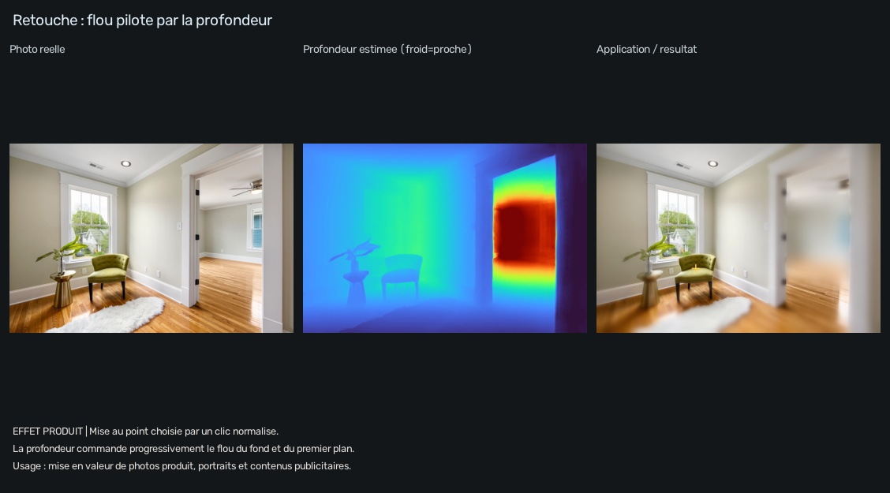

# Monocular Depth Lab — profondeur, reconstruction 3D et applications

À partir d'une photo ou d'une vidéo, ce projet estime la profondeur, reconstruit les surfaces visibles en 3D et applique ces résultats à cinq cas pratiques. Il fonctionne localement sur CPU avec des modèles préentraînés, sans entraînement supplémentaire.

Voir l'[organisation des dossiers et fichiers](docs/STRUCTURE.md) pour retrouver les commandes, les applications, les exemples publics et les données locales.

La version validée est conservée sous le tag Git `v1.0.0`. Voir `VERSION-STABLE.md` pour revenir à cette version et reprendre la branche `developpement`.

Ce projet utilise les dépôts officiels [Depth Anything V2](https://github.com/DepthAnything/Depth-Anything-V2) et [MiDaS](https://github.com/isl-org/MiDaS). Il comprend cinq jeux de poids préentraînés : Depth Anything V2 Small relatif, ses variantes métriques intérieur (Hypersim) et extérieur (Virtual KITTI 2), DPT Hybrid et DPT Large. Aucun dataset n'est nécessaire pour appliquer ces modèles à vos images. Le calcul utilise le CPU ; la mémoire nécessaire dépend du modèle et de la résolution.

## Terminal de VS Code

Ouvrez le dossier du projet dans VS Code, puis **Terminal > Nouveau terminal** et choisissez **PowerShell**. Toutes les commandes ci-dessous s'exécutent depuis la racine du projet, où se trouvent `depth.py`, `reconstruct.py`, `.venv/` et `inputs/`.

Les commandes appellent directement Python dans `.venv` : aucune activation de l'environnement n'est nécessaire. Le [guide des commandes](docs/COMMANDES.md) regroupe les tests sur photos, vidéos, la comparaison des modèles et la reconstruction 3D.

Copiez seulement les commandes des blocs `powershell`, sans le préfixe du terminal (`PS`, `(.venv)` ou `>>`). Si votre terminal affiche déjà `(.venv)`, ces commandes restent valides. Le contenu d'un ancien lanceur, comme `@echo off` ou `%~dp0`, ne doit pas être collé dans PowerShell.

## Applications pratiques

Le dossier [application/](application/README.md) contient cinq démonstrations : perception routière et analyse vidéo, robot aspirateur, flou photographique, prévisualisation de meuble pour une entreprise et inspection de passage industriel. Chaque démonstration inclut des médias réels crédités, un résultat visuel et un rapport d'actions proposées.

| Application | Traitement ajouté | Résultat produit |
|---|---|---|
| [Navigation routière](application/01_navigation_routiere/README.md) | Surfaces saillantes et analyse d'une vidéo frontale | Secteurs annotés, alertes simulées et chronologie |
| [Robot aspirateur](application/02_robot_aspirateur/README.md) | Estimation du sol et surveillance des surfaces au-dessus du sol | Candidats géométriques et proposition de vérification |
| [Traitement d'image](application/03_traitement_image/README.md) | Mise au point choisie et flou selon la profondeur | Photo retouchée et masque d'intensité du flou |
| [Entreprise : aménagement](application/04_entreprise_amenagement/README.md) | Projection d'un gabarit de meuble avec occlusion | Prévisualisation d'un emplacement à confirmer par des mesures |
| [Industrie : passage](application/05_industrie_passage/README.md) | Inspection d'une zone dans un entrepôt | Surfaces à examiner et rapport d'action proposé |

### Consulter les résultats déjà calculés

Les exemples publics sont inclus dans le dépôt. Depuis la racine du projet, ouvrir la galerie hors ligne :

```powershell
Start-Process ".\application\index.html"
```

La galerie contient les cinq applications et une vidéo routière annotée. Aucun serveur ni calcul du modèle n'est nécessaire pour consulter ces résultats. Sur GitHub, les images et les rapports sont accessibles depuis les liens du tableau ci-dessus ; la galerie HTML s'ouvre localement dans un navigateur.




### Relancer les applications

Exécuter les cinq démonstrations sur les photos publiques fournies :

```powershell
.\.venv\Scripts\python.exe -m application.run --demo all
```

Les nouveaux résultats sont dans `results/application/` : images de comparaison, masques, profondeurs brutes, `rapport.json`, `RAPPORT.md` et `index.html`. L'analyse vidéo ajoute une vidéo annotée en MP4 et WebM ainsi qu'une chronologie CSV. `--demo all` traite les cinq exemples photographiques ; la commande de la vidéo frontale est dans le [guide de navigation](application/01_navigation_routiere/README.md).

Pour une photo personnelle et une vidéo, placer les fichiers dans `inputs/`, puis adapter les noms :

```powershell
.\.venv\Scripts\python.exe -m application.run --app robot --input ".\inputs\salon.jpg"
.\.venv\Scripts\python.exe -m application.run --app route --input ".\inputs\trajet.mp4" --every 10 --max-frames 30
```

Chaque commande est indépendante. Les applications acceptent un fichier à la fois ; les modes `photo` et `entreprise` traitent uniquement les photos. Le [guide des applications](application/README.md) explique les réglages de zone surveillée, de sol, de mise au point et de gabarit.

### Résultats observés et limites

La vidéo routière d'exemple comprend douze vues analysées : neuf états de vigilance et trois alertes individuelles à confirmer. La scène de cartons produit une alerte simulée. Ces sorties illustrent le traitement ; elles ne mesurent pas sa précision. Les observations, les omissions et les prochaines étapes sont consignées dans le [bilan des essais réels](application/docs/BILAN.md).

Les usages de navigation sont des prototypes hors ligne avec abstention possible, sans commande d'un véhicule, d'un aspirateur ou d'une machine. Les régions signalées sont des surfaces géométriques, pas des objets reconnus. Les distances et la focale sont estimées ; l'absence de candidat ne garantit pas un passage libre. Le traitement ne détecte pas les trous et les marches descendantes.

Les photos et vidéos publiques, leurs auteurs et leurs licences sont détaillés dans les [sources et crédits](application/docs/SOURCES.md) et le [manifeste des médias](application/assets/SOURCES.json).

## Organisation des dossiers

| Emplacement | Contenu |
|---|---|
| `depth.py`, `reconstruct.py` | Commandes principales de profondeur et de reconstruction |
| `application/run.py`, `application/geometry.py` | Exécution des applications et traitements communs |
| `application/01_.../` à `application/05_.../` | Guides et exemples publics de chaque application |
| `application/assets/` | Photos et courts extraits publics crédités |
| `application/docs/` | Bilan des essais, sources et synthèse JSON |
| `application/tools/` | Outils de préparation des médias et de la galerie |
| `docs/`, `tests/` | Documentation générale et vérifications |
| `inputs/`, `results/` | Médias personnels et résultats de travail, conservés localement |

Les outils de préparation se lancent avec `python -m application.tools.prepare_assets` et `python -m application.tools.build_examples`, en utilisant le Python de `.venv` comme indiqué dans le [guide des applications](application/README.md). L'[arborescence détaillée](docs/STRUCTURE.md) distingue aussi les dépôts de modèles, l'environnement et les sauvegardes locales.

## Vérifications

Les onze tests numériques couvrent la géométrie 3D, la distinction sol/relief sur des scènes synthétiques, l'abstention, le filtre temporel, le flou, l'occlusion et la sélection des exemples publics :

```powershell
.\.venv\Scripts\python.exe -m unittest discover -s tests -p "test_*.py" -v
```

La galerie a également été vérifiée dans un navigateur sur ordinateur et au format mobile, avec lecture de la vidéo WebM. Ces vérifications ne remplacent pas une évaluation sur des scènes annotées ou des distances de référence.

## Reconstruction 3D

Une photo peut être convertie en nuage de points coloré, exporté en PLY et exploré dans une visionneuse hors ligne. Placez vos photos dans `inputs/`, puis choisissez la commande correspondant à votre scène :

Pour toutes les photos d'intérieur dans `inputs/`, copiez cette seule ligne :

```powershell
.\.venv\Scripts\python.exe .\reconstruct.py --input ".\inputs" --model indoor --open
```

Pour les photos d'extérieur :

```powershell
.\.venv\Scripts\python.exe .\reconstruct.py --input ".\inputs" --model outdoor --open
```

Pour une démonstration avec une photo publique fournie par le dépôt officiel :

```powershell
.\.venv\Scripts\python.exe .\reconstruct.py --input ".\source\assets\examples\demo01.jpg" --model outdoor --max-depth 35 --open
```

Exécutez une seule de ces commandes selon le cas. Les sorties sont dans `results/3d/`. `--open` ouvre le premier résultat dans votre navigateur.

Les messages `xFormers not available` peuvent apparaître deux fois : cette optimisation facultative est absente, mais le calcul sur CPU continue. Si le programme indique un nombre de points puis `Ouvrir :` suivi d'un fichier HTML, la reconstruction a réussi. Le nom de ce fichier dépend de votre photo ; ne le recopiez pas comme une commande.


La reconstruction couvre les surfaces visibles. La profondeur est estimée et, sans calibration, la focale est supposée : ce résultat ne fournit pas de dimensions certifiées. Voir le [guide 3D et ses sources](docs/RECONSTRUCTION-3D.md) pour les commandes, les réglages et les limites.

## Exemples de résultats

Les trois modèles ont été exécutés sur la même photo d'exemple du dépôt officiel Depth Anything V2. Chaque image montre la photo à gauche et la profondeur estimée à droite.

### Depth Anything V2 Small


### MiDaS / DPT Hybrid


### DPT Large


Les couleurs sont normalisées séparément pour chaque sortie ; elles ne représentent pas des mètres. Ces exemples montrent le fonctionnement des modèles et permettent de comparer leurs détails visuels, sans mesurer leur précision. Les conditions d'exécution et la source sont documentées dans [docs/examples/README.md](docs/examples/README.md).

## Tester des photos et videos

1. Copiez vos photos et vidéos directement dans le dossier `inputs/`, à la racine du projet (sans sous-dossier).
2. Exécutez la commande ci-dessous dans le terminal PowerShell de VS Code.
3. Ouvrez `results/relative/` pour voir les résultats.

La carte de profondeur apparaît à côté de l'image d'origine. Une vidéo peut prendre longtemps sur CPU : commencez par une courte séquence.

Depuis la racine du projet, exécutez le même test dans PowerShell :

```powershell
.\.venv\Scripts\python.exe .\depth.py --input ".\inputs" --model relative
```

Pour comparer les trois modèles sur la même photo, remplacez `photo.jpg` par le nom de votre fichier puis exécutez :

```powershell
foreach ($modele in @("relative", "hybrid", "large")) {
    .\.venv\Scripts\python.exe .\depth.py --input ".\inputs\photo.jpg" --model $modele
    if ($LASTEXITCODE -ne 0) { throw "Echec du modele : $modele" }
}
```

Chaque modèle tourne successivement afin de limiter l'usage de la mémoire. Les résultats vont dans `results/relative/`, `results/hybrid/` et `results/large/`. Cette comparaison est lente, surtout avec DPT Large.

## Choisir un modèle

Dans PowerShell, depuis ce dossier :

```powershell
.\.venv\Scripts\python.exe .\depth.py --input ".\inputs\photo.jpg" --model relative
.\.venv\Scripts\python.exe .\depth.py --input ".\inputs\indoor.jpg" --model indoor
.\.venv\Scripts\python.exe .\depth.py --input ".\inputs\outdoor.jpg" --model outdoor
.\.venv\Scripts\python.exe .\depth.py --input ".\inputs\photo.jpg" --model hybrid
.\.venv\Scripts\python.exe .\depth.py --input ".\inputs\photo.jpg" --model large
.\.venv\Scripts\python.exe .\depth.py --input ".\inputs\video.mp4" --model relative --max-frames 60
```

`--input` accepte aussi un dossier. Les résultats vont dans `results\<modèle>`. Pour les photos métriques, un fichier `*_meters.npy` conserve les valeurs estimées en mètres. Les images et vidéos de sortie sont réduites à 1280 pixels sur leur plus grand côté pour limiter la mémoire. `--max-side` et `--size` permettent de modifier ces réglages.

La profondeur relative indique l'ordre des distances, sans mètres. DPT Hybrid et DPT Large sont aussi des modèles relatifs. Les modèles métriques sont spécialisés pour l'intérieur ou l'extérieur et leurs estimations ne remplacent pas une mesure réelle. Les couleurs sont normalisées pour chaque image : comparez les détails visuels, pas la valeur des couleurs entre modèles. Aucune comparaison chiffrée de précision n'est possible sans images accompagnées de mesures de profondeur de référence. DPT Large est beaucoup plus lent et consomme plus de mémoire que les autres modèles.

Les dépôts originaux sont dans `source` et `midas`. Les modèles sont dans leurs dossiers `checkpoints` et `weights`. Le programme de ce dossier ne modifie pas et n'entraîne pas ces modèles.

## Fichiers locaux et publication

`inputs/` contient les médias à traiter, et `results/` les sorties. Les médias personnels, résultats locaux, poids, environnements Python et sauvegardes sont exclus de Git. Seul `inputs/README.md` est publié pour documenter le dossier d'entrée. Les illustrations publiques sélectionnées sont dans `docs/examples/`, et les médias et résultats publics des applications dans `application/`. Les exemples de commandes utilisent des chemins relatifs à la racine du projet.
