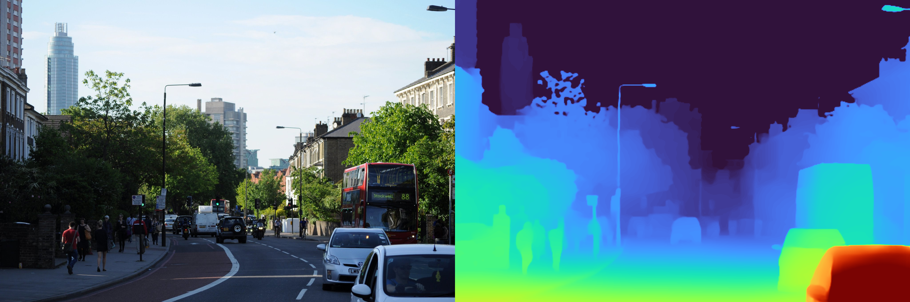
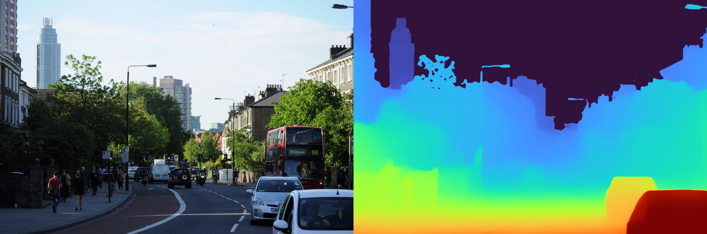
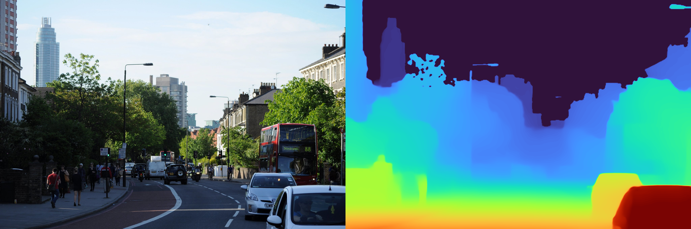

# Test local de profondeur, sans entraînement

La version validée est conservée sous le tag Git `v1.0.0`. Voir `VERSION-STABLE.md` pour revenir à cette version et reprendre la branche `developpement`.

Ce projet utilise les dépôts officiels [Depth Anything V2](https://github.com/DepthAnything/Depth-Anything-V2) et [MiDaS](https://github.com/isl-org/MiDaS). Il comprend cinq jeux de poids préentraînés : Depth Anything V2 Small relatif, ses variantes métriques intérieur (Hypersim) et extérieur (Virtual KITTI 2), DPT Hybrid et DPT Large. Aucun dataset n'est nécessaire pour appliquer ces modèles à vos images. Le calcul utilise le CPU ; la mémoire nécessaire dépend du modèle et de la résolution.

## Exemples de résultats

Les trois modèles ont été exécutés sur la même photo d'exemple du dépôt officiel Depth Anything V2. Chaque image montre la photo à gauche et la profondeur estimée à droite.

### Depth Anything V2 Small



### MiDaS / DPT Hybrid



### DPT Large



Les couleurs sont normalisées séparément pour chaque sortie ; elles ne représentent pas des mètres. Ces exemples montrent le fonctionnement des modèles et permettent de comparer leurs détails visuels, sans mesurer leur précision. Les conditions d'exécution et la source sont documentées dans [docs/examples/README.md](docs/examples/README.md).

## Essai facile

1. Copiez vos photos et vidéos directement dans le dossier `inputs/`, à la racine du projet (sans sous-dossier).
2. Double-cliquez sur `Tester-photos-videos.cmd`, à la racine du projet.
3. Ouvrez `results/relative/` pour voir les résultats.

Vous pouvez aussi glisser une photo, une vidéo ou un autre dossier sur `Tester-photos-videos.cmd`. La carte de profondeur apparaît à côté de l'image d'origine. Une vidéo peut prendre longtemps sur CPU : commencez par une courte séquence.

Depuis la racine du projet, exécutez le même test dans PowerShell :

```powershell
.\.venv\Scripts\python.exe .\depth.py --input ".\inputs" --model relative
```

Pour comparer les trois modèles de la discussion sur la même photo, glissez la photo sur `Comparer-les-modeles.cmd`. Chaque modèle tourne successivement afin de limiter l'usage de la mémoire. Cette comparaison est lente, surtout avec DPT Large.

## Choisir un modèle

Dans PowerShell, depuis ce dossier :

```powershell
.\.venv\Scripts\python.exe .\depth.py --input ".\inputs\photo.jpg" --model relative
.\.venv\Scripts\python.exe .\depth.py --input ".\inputs\indoor.jpg" --model indoor
.\.venv\Scripts\python.exe .\depth.py --input ".\inputs\outdoor.jpg" --model outdoor
.\.venv\Scripts\python.exe .\depth.py --input ".\inputs\photo.jpg" --model hybrid
.\.venv\Scripts\python.exe .\depth.py --input ".\inputs\photo.jpg" --model large
.\.venv\Scripts\python.exe .\depth.py --input ".\inputs\video.mp4" --model relative --max-frames 60
```

`--input` accepte aussi un dossier. Les résultats vont dans `results\<modèle>`. Pour les photos métriques, un fichier `*_meters.npy` conserve les valeurs estimées en mètres. Les images et vidéos de sortie sont réduites à 1280 pixels sur leur plus grand côté pour limiter la mémoire. `--max-side` et `--size` permettent de modifier ces réglages.

La profondeur relative indique l'ordre des distances, sans mètres. DPT Hybrid et DPT Large sont aussi des modèles relatifs. Les modèles métriques sont spécialisés pour l'intérieur ou l'extérieur et leurs estimations ne remplacent pas une mesure réelle. Les couleurs sont normalisées pour chaque image : comparez les détails visuels, pas la valeur des couleurs entre modèles. Aucune comparaison chiffrée de précision n'est possible sans images accompagnées de mesures de profondeur de référence. DPT Large est beaucoup plus lent et consomme plus de mémoire que les autres modèles.

Les dépôts originaux sont dans `source` et `midas`. Les modèles sont dans leurs dossiers `checkpoints` et `weights`. Le programme de ce dossier ne modifie pas et n'entraîne pas ces modèles.

## Fichiers locaux et publication

`inputs/` contient les médias à traiter, et `results/` les sorties. Les médias personnels, résultats locaux, poids, environnements Python et sauvegardes sont exclus de Git. Seul `inputs/README.md` est publié pour documenter le dossier d'entrée. Les illustrations publiques sélectionnées sont conservées séparément dans `docs/examples/`. Les exemples de commandes utilisent des chemins relatifs à la racine du projet.
