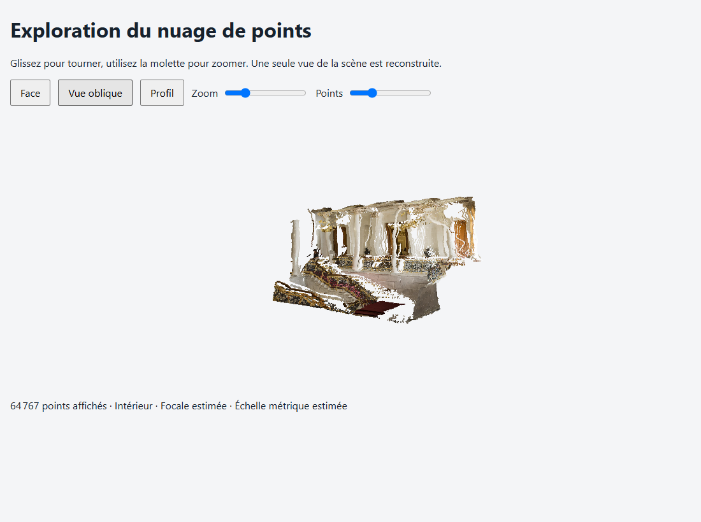

# Test local de profondeur, sans entraînement

La version validée est conservée sous le tag Git `v1.0.0`. Voir `VERSION-STABLE.md` pour revenir à cette version et reprendre la branche `developpement`.

Ce projet utilise les dépôts officiels [Depth Anything V2](https://github.com/DepthAnything/Depth-Anything-V2) et [MiDaS](https://github.com/isl-org/MiDaS). Il comprend cinq jeux de poids préentraînés : Depth Anything V2 Small relatif, ses variantes métriques intérieur (Hypersim) et extérieur (Virtual KITTI 2), DPT Hybrid et DPT Large. Aucun dataset n'est nécessaire pour appliquer ces modèles à vos images. Le calcul utilise le CPU ; la mémoire nécessaire dépend du modèle et de la résolution.

## Terminal de VS Code

Ouvrez le dossier du projet dans VS Code, puis **Terminal > Nouveau terminal** et choisissez **PowerShell**. Toutes les commandes ci-dessous s'exécutent depuis la racine du projet, où se trouvent `depth.py`, `reconstruct.py`, `.venv/` et `inputs/`.

Les commandes appellent directement Python dans `.venv` : aucune activation de l'environnement n'est nécessaire. Le [guide des commandes](docs/COMMANDES.md) regroupe les tests sur photos, vidéos, la comparaison des modèles et la reconstruction 3D.

Copiez seulement les commandes des blocs `powershell`, sans le préfixe du terminal (`PS`, `(.venv)` ou `>>`). Si votre terminal affiche déjà `(.venv)`, ces commandes restent valides. Le contenu d'un ancien lanceur, comme `@echo off` ou `%~dp0`, ne doit pas être collé dans PowerShell.

## Reconstruction 3D

Une photo peut être convertie en nuage de points coloré, exporté en PLY et exploré dans une visionneuse hors ligne. Placez vos photos dans `inputs/`, puis choisissez la commande correspondant à votre scène :

Pour toutes les photos d'intérieur dans `inputs/`, copiez cette seule ligne :

```powershell
.\.venv\Scripts\python.exe .\reconstruct.py --input ".\inputs" --model indoor --open
```

Pour les photos d'extérieur :

```powershell
.\.venv\Scripts\python.exe .\reconstruct.py --input ".\inputs" --model outdoor --open
```

Pour une démonstration avec une photo publique fournie par le dépôt officiel :

```powershell
.\.venv\Scripts\python.exe .\reconstruct.py --input ".\source\assets\examples\demo01.jpg" --model outdoor --max-depth 35 --open
```

Exécutez une seule de ces commandes selon le cas. Les sorties sont dans `results/3d/`. `--open` ouvre le premier résultat dans votre navigateur.

Les messages `xFormers not available` peuvent apparaître deux fois : cette optimisation facultative est absente, mais le calcul sur CPU continue. Si le programme indique un nombre de points puis `Ouvrir :` suivi d'un fichier HTML, la reconstruction a réussi. Le nom de ce fichier dépend de votre photo ; ne le recopiez pas comme une commande.



La reconstruction couvre les surfaces visibles. La profondeur est estimée et, sans calibration, la focale est supposée : ce résultat ne fournit pas de dimensions certifiées. Voir le [guide 3D et ses sources](docs/RECONSTRUCTION-3D.md) pour les commandes, les réglages et les limites.

## Exemples de résultats

Les trois modèles ont été exécutés sur la même photo d'exemple du dépôt officiel Depth Anything V2. Chaque image montre la photo à gauche et la profondeur estimée à droite.

### Depth Anything V2 Small


### MiDaS / DPT Hybrid


### DPT Large


Les couleurs sont normalisées séparément pour chaque sortie ; elles ne représentent pas des mètres. Ces exemples montrent le fonctionnement des modèles et permettent de comparer leurs détails visuels, sans mesurer leur précision. Les conditions d'exécution et la source sont documentées dans [docs/examples/README.md](docs/examples/README.md).

## Tester des photos et videos

1. Copiez vos photos et vidéos directement dans le dossier `inputs/`, à la racine du projet (sans sous-dossier).
2. Exécutez la commande ci-dessous dans le terminal PowerShell de VS Code.
3. Ouvrez `results/relative/` pour voir les résultats.

La carte de profondeur apparaît à côté de l'image d'origine. Une vidéo peut prendre longtemps sur CPU : commencez par une courte séquence.

Depuis la racine du projet, exécutez le même test dans PowerShell :

```powershell
.\.venv\Scripts\python.exe .\depth.py --input ".\inputs" --model relative
```

Pour comparer les trois modèles sur la même photo, remplacez `photo.jpg` par le nom de votre fichier puis exécutez :

```powershell
foreach ($modele in @("relative", "hybrid", "large")) {
    .\.venv\Scripts\python.exe .\depth.py --input ".\inputs\photo.jpg" --model $modele
    if ($LASTEXITCODE -ne 0) { throw "Echec du modele : $modele" }
}
```

Chaque modèle tourne successivement afin de limiter l'usage de la mémoire. Les résultats vont dans `results/relative/`, `results/hybrid/` et `results/large/`. Cette comparaison est lente, surtout avec DPT Large.

## Choisir un modèle

Dans PowerShell, depuis ce dossier :

```powershell
.\.venv\Scripts\python.exe .\depth.py --input ".\inputs\photo.jpg" --model relative
.\.venv\Scripts\python.exe .\depth.py --input ".\inputs\indoor.jpg" --model indoor
.\.venv\Scripts\python.exe .\depth.py --input ".\inputs\outdoor.jpg" --model outdoor
.\.venv\Scripts\python.exe .\depth.py --input ".\inputs\photo.jpg" --model hybrid
.\.venv\Scripts\python.exe .\depth.py --input ".\inputs\photo.jpg" --model large
.\.venv\Scripts\python.exe .\depth.py --input ".\inputs\video.mp4" --model relative --max-frames 60
```

`--input` accepte aussi un dossier. Les résultats vont dans `results\<modèle>`. Pour les photos métriques, un fichier `*_meters.npy` conserve les valeurs estimées en mètres. Les images et vidéos de sortie sont réduites à 1280 pixels sur leur plus grand côté pour limiter la mémoire. `--max-side` et `--size` permettent de modifier ces réglages.

La profondeur relative indique l'ordre des distances, sans mètres. DPT Hybrid et DPT Large sont aussi des modèles relatifs. Les modèles métriques sont spécialisés pour l'intérieur ou l'extérieur et leurs estimations ne remplacent pas une mesure réelle. Les couleurs sont normalisées pour chaque image : comparez les détails visuels, pas la valeur des couleurs entre modèles. Aucune comparaison chiffrée de précision n'est possible sans images accompagnées de mesures de profondeur de référence. DPT Large est beaucoup plus lent et consomme plus de mémoire que les autres modèles.

Les dépôts originaux sont dans `source` et `midas`. Les modèles sont dans leurs dossiers `checkpoints` et `weights`. Le programme de ce dossier ne modifie pas et n'entraîne pas ces modèles.

## Fichiers locaux et publication

`inputs/` contient les médias à traiter, et `results/` les sorties. Les médias personnels, résultats locaux, poids, environnements Python et sauvegardes sont exclus de Git. Seul `inputs/README.md` est publié pour documenter le dossier d'entrée. Les illustrations publiques sélectionnées sont conservées séparément dans `docs/examples/`. Les exemples de commandes utilisent des chemins relatifs à la racine du projet.
