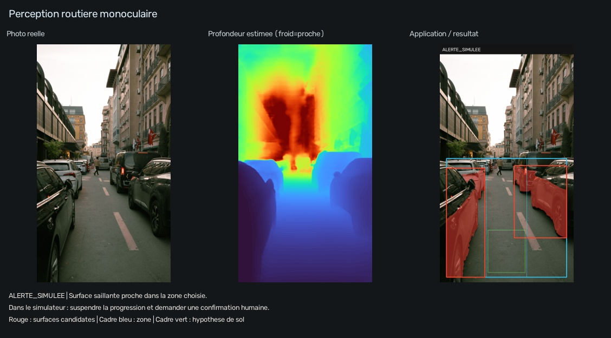
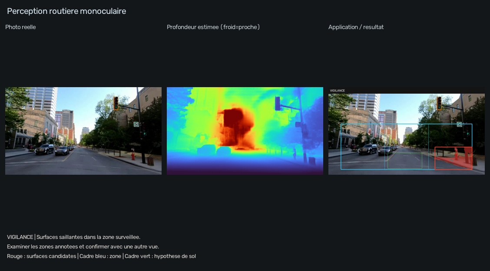

# Navigation routière et obstacles en vidéo

**Problème :** exploiter une caméra RGB pour examiner des surfaces proches sur la route, sans LiDAR pendant l'inférence. **Utilisateur :** étudiant ou équipe qui prépare des essais de perception dans un simulateur.

La photo réelle de rue contient des véhicules de part et d'autre. Le programme projette la profondeur dans l'espace, estime le sol dans le rectangle vert et marque des surfaces saillantes dans les secteurs surveillés. Les rectangles rouges ne sont pas des détections sémantiques de voitures ou de piétons.



Action possible : suspendre la progression dans un simulateur et examiner les régions annotées. Le résultat ne contient ni angle de braquage, ni commande de freinage, ni trajectoire considérée comme sûre. Une surface sur le côté peut être proche sans obstruer la voie : l'alerte porte sur la zone surveillée, pas sur une collision prédite.

[Rapport photo calculé](exemples/RAPPORT.md) · [Mesures et paramètres](exemples/rapport.json)

## Photo de démonstration

```powershell
.\.venv\Scripts\python.exe -m application.run --demo route
```

## Véritable vidéo de caméra frontale

Extrait public de six secondes, redimensionné, sans audio. Une image sur quinze est analysée ; douze vues produisent la vidéo de sortie à la cadence réduite correspondante. Ce n'est pas une démonstration temps réel.

```powershell
.\.venv\Scripts\python.exe -m application.run --app route --input ".\application\assets\dashcam.mp4" --max-frames 12 --every 15 --fov 75 --roi 0.08 0.42 0.92 0.94 --seed 0.38 0.75 0.60 0.93 --output ".\results\application\video_route"
Start-Process ".\results\application\video_route\index.html"
```



[Vidéo WebM pour navigateur](video/video_annotee.webm) · [Version MP4](video/video_annotee.mp4) · [Chronologie CSV](video/chronologie.csv) · [Rapport des douze vues](video/RAPPORT.md)

La profondeur est calculée indépendamment sur chaque vue. Le compteur temporel exige trois alertes consécutives pour afficher l'état confirmé `ALERTE_SIMULEE`, mais la première alerte reste visible comme `ALERTE_A_CONFIRMER`. Les variations de sol ou l'incertitude peuvent remettre le compteur à zéro. Aucun suivi de véhicule ni calcul de vitesse n'est réalisé.

## Cas de caméra inadaptée

Une seconde vidéo réelle regarde par une fenêtre latérale ; elle n'est pas appropriée à l'analyse du passage devant une voiture. L'option suivante **déclare ce fait au programme** et provoque l'abstention. Elle ne teste pas une reconnaissance automatique du montage de caméra.

```powershell
.\.venv\Scripts\python.exe -m application.run --app route --input ".\application\assets\camera-laterale.mp4" --camera-lateral --max-frames 6 --every 20 --max-side 512 --output ".\results\application\video_camera_laterale"
```

[Rapport d'abstention](camera_inadaptee/RAPPORT.md)

## Passer à des essais plus représentatifs

Calibrer une caméra frontale fixe, annoter des obstacles et des cas difficiles, mesurer les erreurs et la latence sur l'appareil cible, puis tester dans un simulateur. La validation peut nécessiter des distances de référence ou d'autres capteurs même si l'inférence utilise uniquement une caméra. La présente application ne constitue pas un système de conduite autonome.

[Sources et crédits](../SOURCES.md)
