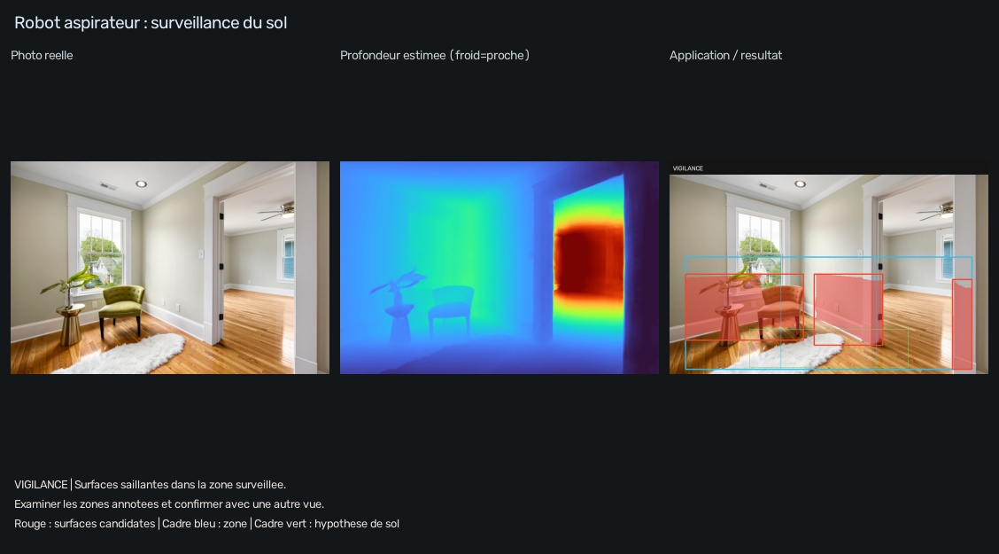

# Robot aspirateur : surfaces au-dessus du sol

**Problème :** préparer une perception visuelle d'obstacles sans ajouter de LiDAR au robot. **Résultat :** une image annotée et une proposition de vérification ou de pause dans un simulateur.



La sélection du sol évite de considérer tous les pixels proches comme des obstacles. Le programme cherche des surfaces dont la hauteur estimée dépasse 8 cm au-dessus du plan choisi, dans une zone limitée à une profondeur estimée de 6 m. Les seuils sont expérimentaux : ils ne prouvent pas une précision de 8 cm. Un tapis peut être confondu avec le sol ou un relief, et des pieds fins peuvent être éliminés par le filtre.

[Résultat et action calculés](exemples/RAPPORT.md) · [Paramètres exacts](exemples/rapport.json)

```powershell
.\.venv\Scripts\python.exe -m application.run --demo robot
.\.venv\Scripts\python.exe -m application.run --app robot --input ".\inputs\salon.jpg"
```

Fusion avec l'analyse d'obstacles dans une vidéo personnelle :

```powershell
.\.venv\Scripts\python.exe -m application.run --app robot --input ".\inputs\parcours.mp4" --every 10 --max-frames 30 --output ".\results\application\video_robot"
```

L'action proposée dépend du résultat. `VIGILANCE` demande une autre vue ; `ALERTE_SIMULEE` propose une pause dans le simulateur et une confirmation avant contournement. Aucun signal n'est envoyé à un robot, et aucun itinéraire n'est calculé.

La photographie fournie est prise à hauteur humaine : elle valide le traitement, **pas son adaptation à une caméra basse d'aspirateur**. Pour la suite, filmer à la hauteur réelle du robot, régler le rectangle de sol et évaluer chaussures, câbles, pieds de meuble, seuils et changements de revêtement. Les trous et escaliers descendants ne sont pas détectés par cette version.

[Guide commun](../README.md) · [Sources et crédits](../docs/SOURCES.md)
