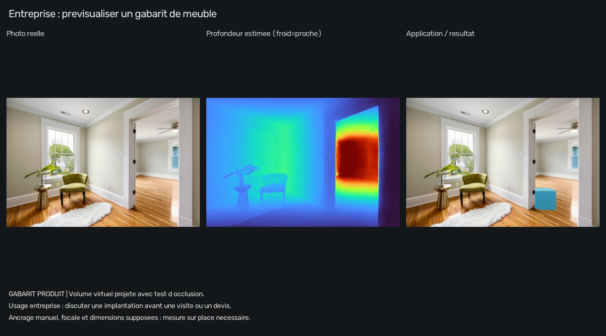

# Entreprise : prévisualiser un emplacement de meuble

**Client possible :** vendeur de mobilier, agence d'aménagement ou artisan. **Problème :** discuter une implantation avec un client avant une visite ou un devis.



La profondeur donne un point d'ancrage 3D choisi manuellement sur le sol. Le programme construit un volume cubique, projette ses faces dans la photo et compare sa profondeur à celle de la scène : les surfaces réelles plus proches masquent le volume virtuel. Un masque des pixels visibles permet de contrôler ce traitement.

```powershell
.\.venv\Scripts\python.exe -m application.run --demo entreprise
.\.venv\Scripts\python.exe -m application.run --app entreprise --input ".\inputs\piece.jpg" --anchor 0.70 0.85 --dimensions 0.8 0.7 0.55
```

`--dimensions` signifie largeur, hauteur, profondeur supposées en mètres. Le gabarit est illustratif : ce n'est pas un meuble provenant d'un catalogue. Sa taille apparente dépend de la profondeur et de la focale estimées. Les axes du volume suivent ceux de la caméra ; une caméra fortement inclinée demande une correction supplémentaire avant une implantation réaliste.

**Action :** comparer plusieurs emplacements, choisir celui à étudier, puis prendre les mesures nécessaires sur place. Cette version ne fournit ni verdict « cela rentre », ni dimensions garanties, ni prix ou gain commercial mesuré.

Valeur ajoutée possible après cette étape : charger de vrais modèles de catalogue, calibrer avec une dimension connue, adapter l'orientation au plan de sol et comparer plusieurs implantations dans une même interface.

[Rapport et pixels d'occlusion](exemples/RAPPORT.md) · [Données calculées](exemples/rapport.json) · [Sources](../docs/SOURCES.md)
