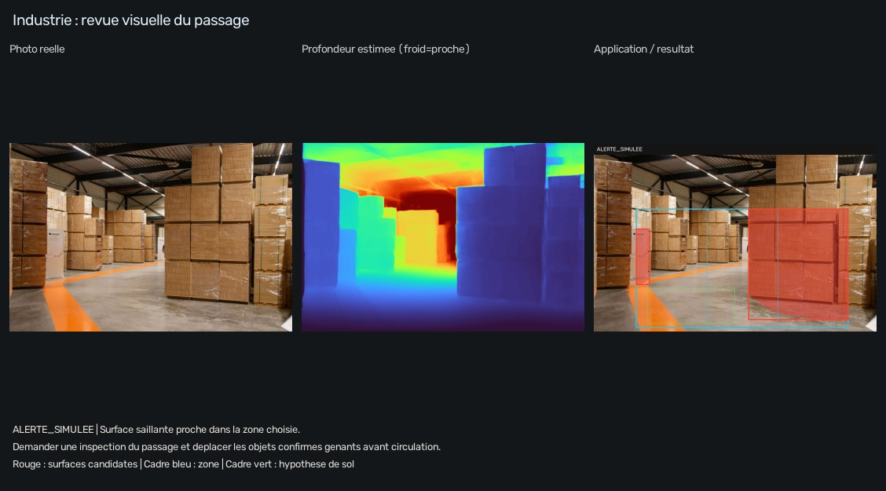
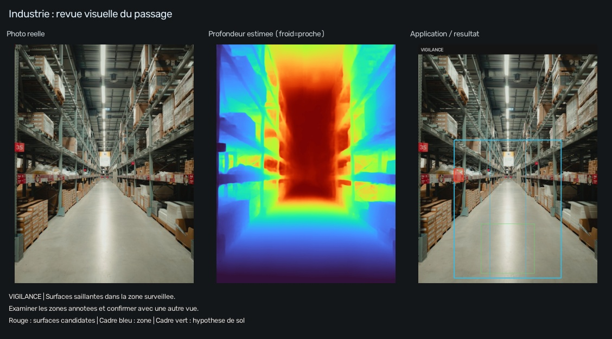

# Industrie : revue visuelle d'un passage

**Utilisateur :** responsable d'atelier ou d'entrepôt. **Problème :** repérer les régions d'une photo qui méritent une inspection avant circulation ou déplacement de stocks.



Le programme estime un sol plan dans la zone verte et marque des surfaces saillantes dans le rectangle de surveillance. Il ne reconnaît pas les cartons, les personnes ou les chariots. Les piles latérales visibles sont de vraies surfaces, mais leur proximité ne prouve pas à elle seule que le passage central est obstrué. Le rectangle doit représenter la zone que le responsable souhaite surveiller.

[Rapport calculé sur les cartons](exemples/RAPPORT.md) · [Mesures et seuils](exemples/rapport.json)

```powershell
.\.venv\Scripts\python.exe -m application.run --demo industrie
```

## Deuxième scène réelle : allée d'entrepôt



```powershell
.\.venv\Scripts\python.exe -m application.run --app industrie --input ".\application\assets\warehouse.jpg" --output ".\results\application\industrie_allee" --seed 0.35 0.75 0.65 0.96 --roi 0.20 0.40 0.80 0.98
```

[Rapport de l'allée](allee/RAPPORT.md). Les rayonnages et les bords du passage peuvent produire des candidats. Aucun de ces essais n'est une mesure de largeur utile ou une certification de conformité.

**Action proposée :** examiner les régions marquées, confirmer sur place celles qui gênent réellement le passage et demander leur déplacement si nécessaire. Une abstention conduit à changer de vue ou vérifier la caméra, plutôt qu'à déclarer l'allée libre.

Pour vos médias, remplacer l'entrée par `inputs/atelier.jpg` ou une vidéo et définir `--roi` pour le passage surveillé. Une zone surveillée fixe dans l'image n'est cohérente dans le temps que si le montage de la caméra et le contexte conviennent.

Une étape industrielle sérieuse nécessiterait caméra fixe calibrée, zone de passage définie sur le sol, exemples annotés, comparaison aux distances réelles et mesure des fausses alertes et des obstacles manqués. Cette démonstration ne constitue pas un dispositif de sécurité machine.

[Guide commun](../README.md) · [Sources et crédits](../SOURCES.md)
